# Pitch Insights Engine

[](https://github.com/Yahya-Younes/pitch-insights-engine/actions/workflows/ci.yml)

**Live football commentary from AI agents, where every stat is fact-checked before it airs.**

A live football-match-intelligence system built on **Microsoft Agent Framework** and **Azure AI Foundry** for Microsoft + Premier League's "Inside the Game" Developer Hackathon.

A synthetic match plays out event-by-event through a 5-stage multi-agent pipeline — **Scout → Analyst-0 → Narrator → {Broadcaster, Concierge}** — that turns raw events into fact-checked, persona-aware commentary, live on screen, with every claim verified against the data that produced it before it ever reaches a viewer.

| | |
|---|---|
| **Live demo** | https://ambitious-sand-0eeec890f.2.azurestaticapps.net |
| **Pitch video** (1:47, narrated) | [`pitch.mp4`](pitch.mp4) |
| **Screenshots** | [below](#screenshots), or the [`screenshots/`](screenshots) folder |

The pitch video shows a live match from kickoff with no cuts:
- the five agents at work and the first fact-checked insight on screen in seconds;
- the match centre;
- the trust figures, measured live;
- an attempt to make the narrator lie.

[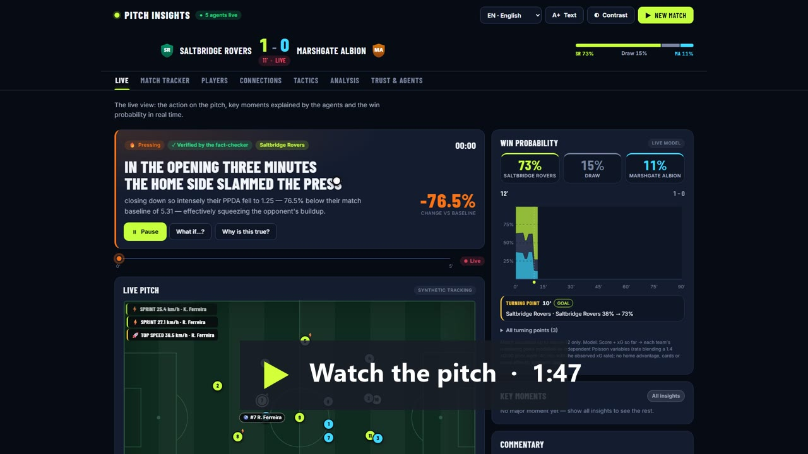](pitch.mp4)

## Why this exists

Most AI sports-commentary demos either hallucinate stats or read like a press release. This project's whole premise is **explainability you can check**: every number the system states traces back to a specific `InsightCandidate` it computed; every claim is run through a live grounding checker before publication; and the headline accuracy numbers below are computed by the running system on every page load, not asserted in this file.

## How it works

| Stage | Agent | What it does |
|---|---|---|
| (a) | **Scout** | Ingests and validates raw match events (from a live demo run or the Event Hubs stream) |
| (b) | **Analyst-0** | Deterministic, no-LLM football analytics: PPDA (pressing intensity), a chaos/control composite, tempo z-scores, Expected Threat (Karun Singh-style Markov value iteration), pass difficulty, referee positioning quality, and player-tendency inference — each a named, real analytics concept, honestly documented where it's hand-calibrated rather than fit from data |
| (c) | **Narrator** | Explains *why* a flagged moment matters, in 1-2 sentences, grounded only in that insight's own fields |
| (d) | **Broadcaster** | Deterministic, zero-LLM: builds the broadcast-graphics overlay payload from the Narrator's verified output |
| (e) | **Concierge** | Personalizes the same insights for a chosen viewer persona and Coach Lens, in the viewer's chosen language |

Every stage's input/output is recorded to a shared handoff log (Cosmos DB in production), giving a concrete, inspectable orchestration trace per match — see `GET /matches/{id}/handoff`.

## Screenshots

Captured on the live deployment. Full-size images are in [`screenshots/`](screenshots).

| | |
|---|---|
| <a href="screenshots/01-landing.png">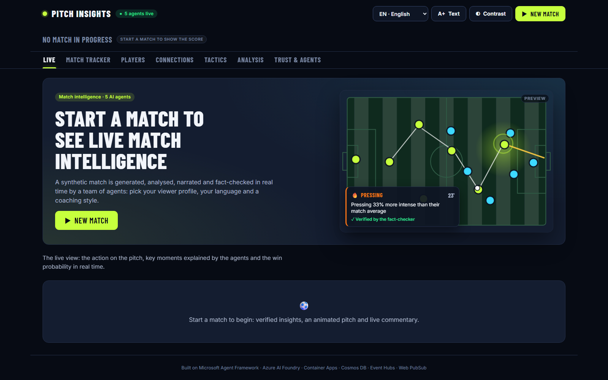</a><br>**Landing**: An animated preview of what a live insight looks like. | <a href="screenshots/02-new-match.png">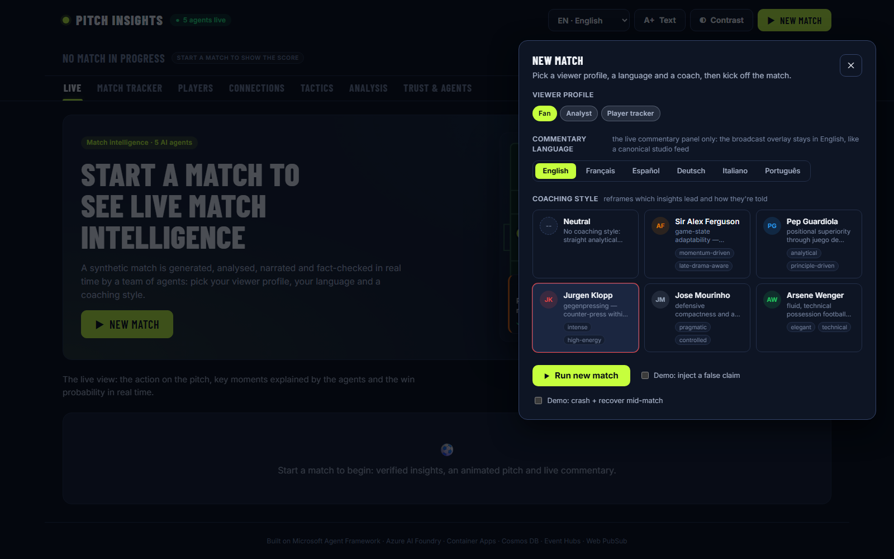</a><br>**New match**: Pick a viewer profile, one of 6 languages and a coaching lens. |
| <a href="screenshots/03-agents-at-work.png">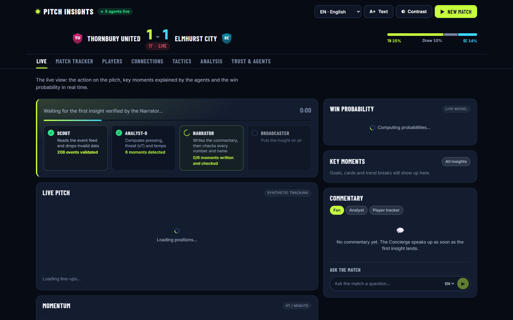</a><br>**Agents at work**: Real progress from the agent trace, until the first verified insight (~6 s). | <a href="screenshots/04-live-insight.png">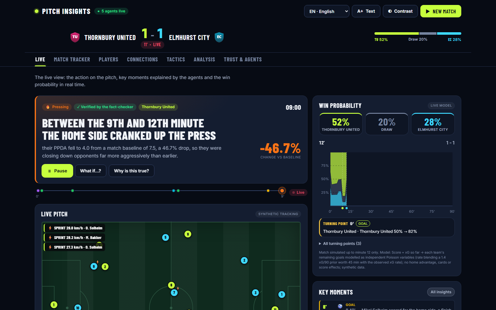</a><br>**Live insight**: The current moment, verified by the fact-checker, next to the live win probability. |
| <a href="screenshots/05-live-pitch-and-commentary.png">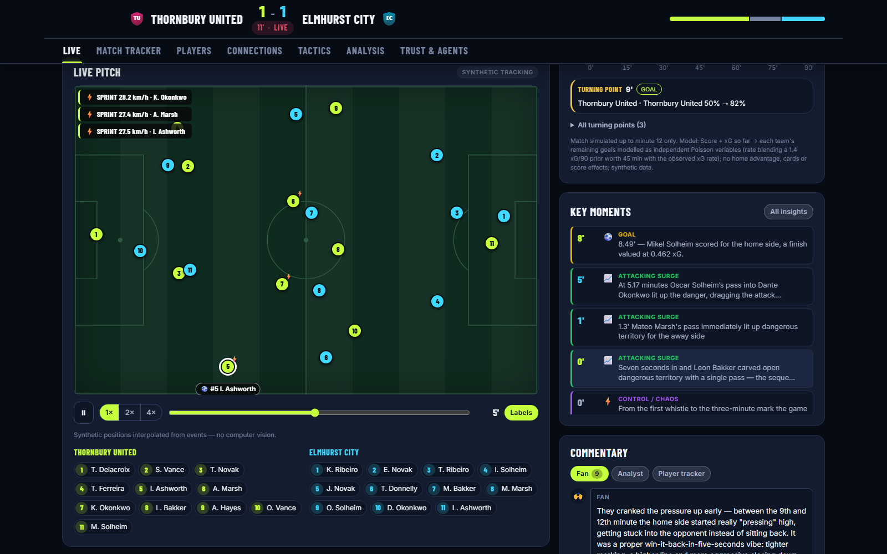</a><br>**Pitch and commentary**: Synthetic tracking, key moments, and the commentary rewritten for the viewer's profile. | <a href="screenshots/06-match-tracker.png">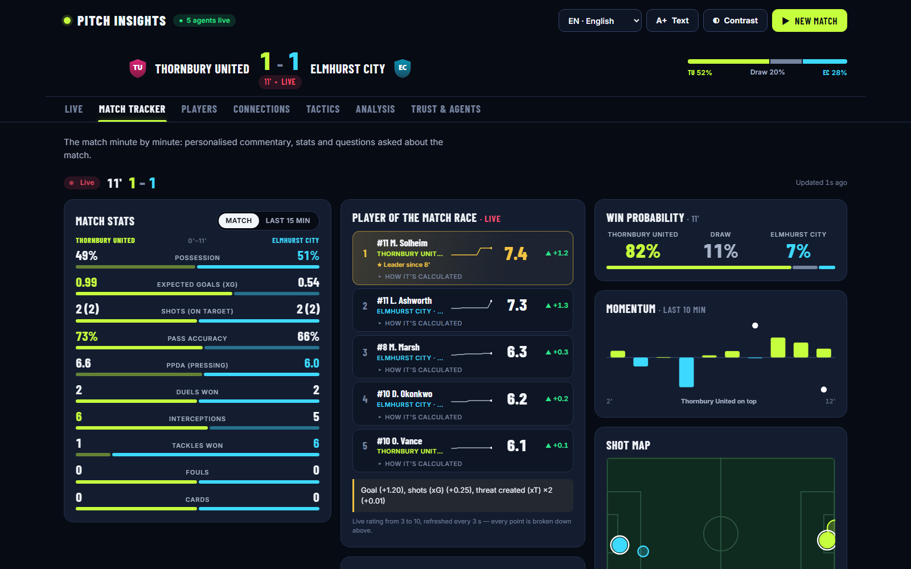</a><br>**Match tracker**: Minute-by-minute stats, player of the match, momentum and shot map. |
| <a href="screenshots/07-players.png">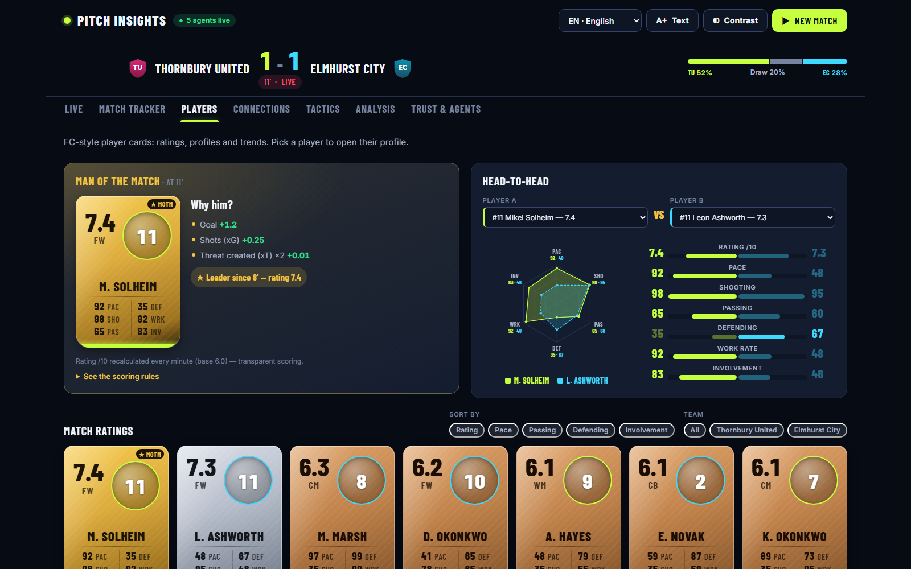</a><br>**Players**: FC-style ratings recalculated as the match goes, with a head-to-head comparison. | <a href="screenshots/08-connections.png">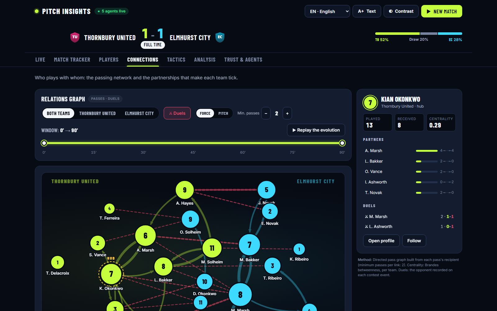</a><br>**Connections**: Passing network and partnerships, replayable over the match. |
| <a href="screenshots/09-tactics.png">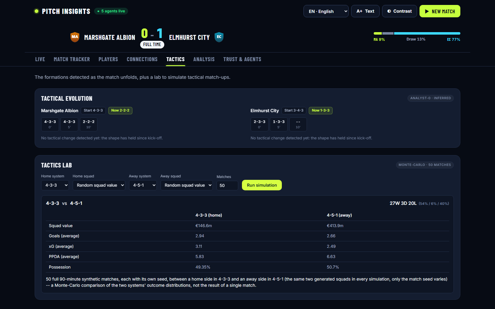</a><br>**Tactics**: Formations detected live, and a Monte-Carlo Tactics Lab. | <a href="screenshots/10-analysis.png">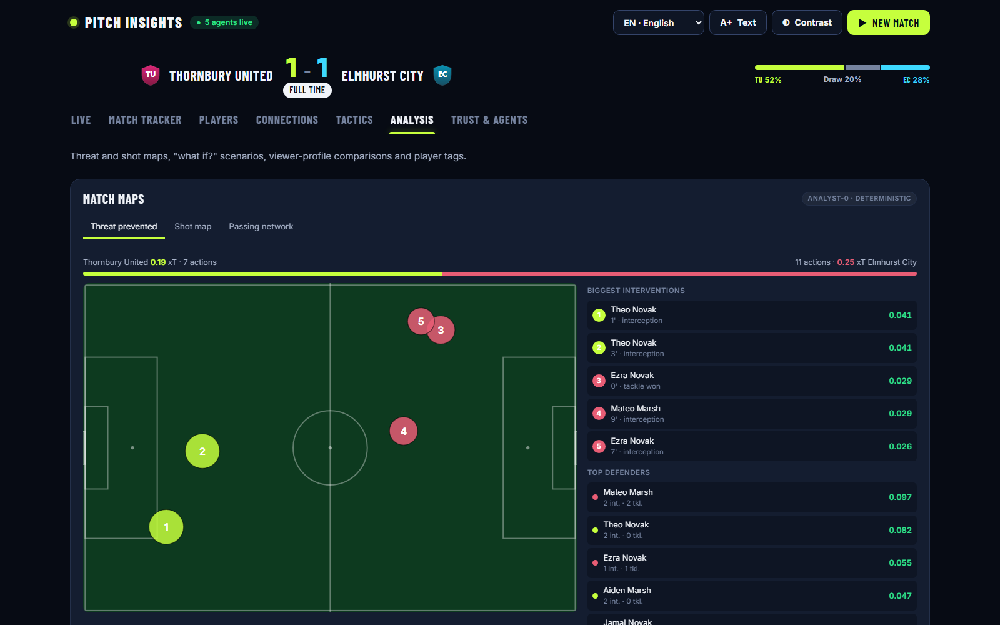</a><br>**Analysis**: Threat and shot maps, and "what if?" scenarios recomputed by Analyst-0. |
| <a href="screenshots/11-trust-and-agents.png">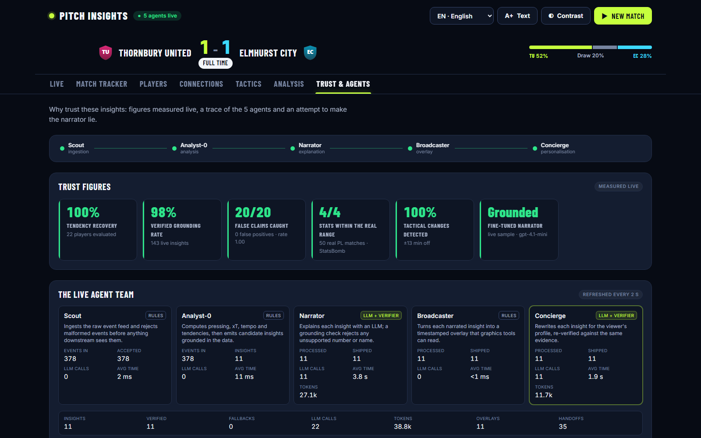</a><br>**Trust & agents**: Trust figures measured live, and each agent's calls, tokens and latency. | <a href="screenshots/12-make-it-lie.png">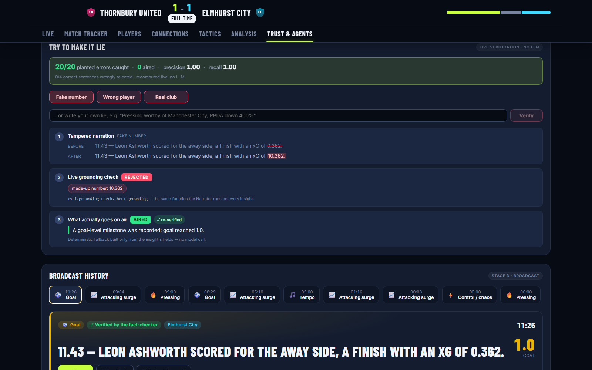</a><br>**Make it lie**: Plant a fake number: the live checker rejects it and a verified fallback goes on air. |

<p align="center">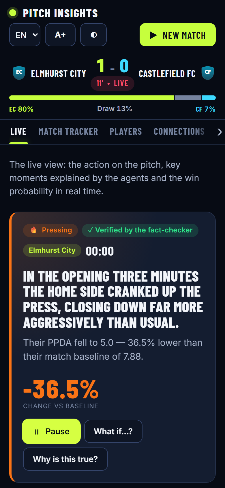<br><b>On a phone</b>: the same live view, responsive down to 360 px.</p>

## Live, checkable numbers

`GET /stats` (and the badges at the top of the live demo) report four numbers computed fresh by the running system, not hardcoded:

- **Tendency-recovery accuracy** — how well a purely frequency-based inference model (never shown the generator's hidden ground truth) recovers each player's actual dominant behavioral tendency, scored against that hidden ground truth.
- **Grounding pass rate** — the real pass/fail rate of the live grounding checker (`eval/grounding_check.py`) across actual Narrator/Concierge output from live-run matches, not an offline-only test.
- **Fact-checking scorecard** — deliberately corrupted narrations (fabricated numbers, wrong-but-real player names, off-topic phrasing) run through the same live grounding checker on every request, reporting a real catch rate and false-positive rate.
- **Real-match realism scorecard** — our synthetic generator's basic match statistics (pressing intensity, pass completion, shot volume, possession split) compared against the literal min-max range observed across a real sample of StatsBomb Open Data Premier League matches (2003/04 + 2015/16 seasons — `eval/real_data_validation.py`, `tools/fetch_real_data_validation.py`), not a hand-typed table of publicly reported numbers. Reported **honestly either way**, and the sample size/provenance ships in the response itself rather than being asserted in prose.

## Features

- **5-stage live orchestration** via Microsoft Agent Framework's `WorkflowBuilder`, deployed on Azure Container Apps, with every insight individually fact-checked before it ships.
- **Real workflow checkpoint/resume** using Agent Framework's native `CheckpointStorage` — a demo toggle ("crash + recover mid-match") deliberately crashes the pipeline mid-run and resumes it from its last checkpoint, without re-running already-completed stages. Also fixed two real bugs discovered while wiring this in: Narrator/Concierge used to silently drop an insight on any LLM failure (now retries once, then falls back instead of disappearing), and the Event Hubs consumer could lose an in-flight match's events on a crash (now checkpoints only after a match is confirmed fully processed).
- **Continuous player/ball position tracking + an animated pitch view** — synthetic, interpolated from the match's own recorded event locations (a physics-style arc for the ball on passes/shots), *not* computer vision or real tracking, exactly as disclosed.
- **"What If?" counterfactual scoring** — re-runs the same deterministic Analyst-0 function that produced an insight's real metric (Expected Threat, referee positioning quality, tendency alignment) against a hypothetical alternate input a viewer picks, returning a genuinely recomputed number, not an LLM guess.
- **An MCP server** (`/mcp`, mounted on the same Container App) exposing match insights, the live fact-checking scorecard, and a grounded Q&A tool as callable tools for any MCP-compatible client — not just this project's own frontend.
- **5 real-manager Coach Lenses** (Ferguson, Guardiola, Klopp, Mourinho, Wenger) that reframe which insights lead and how they're told, sourced from each manager's documented tactical philosophy.
- **Referee Decision Analytics** — positioning-quality scoring grounded in the Diagonal System of Control, with an IFAB Law citation, an estimated-impact heuristic, and an honest "too close to call" band instead of always presenting a confident verdict.
- **Player Tendency Profiles**, inferred purely from observed events (never from hidden ground truth) and scored against that ground truth only for the offline accuracy report above. Uncapped, tendency detection would flood the feed (~150 mostly "player did what they usually do" insights per match), so the live feed emits only the 5 most striking `tendency_break` moments per match (`TENDENCY_MAX_PER_MATCH` in `agents/analyst0/insight_generator.py`).
- **Multi-language narration and Q&A** (EN/FR/ES/DE/IT/PT) via Azure AI Speech voice synthesis, with a per-locale football glossary (`agents/shared/glossary.py`) that both steers translation and restores real vocabulary fact-checking for non-English output — previously, non-English narration had that check silently skipped entirely.
- **A grounded "Ask the Match" Q&A agent** that answers only from insights this system has actually verified for that match, and says so honestly when something hasn't come up yet rather than guessing.
- **Live Application Insights tracing** (OpenTelemetry), with trace IDs correlated into the handoff log so a judge can follow one request end-to-end.
- **A fine-tuned Narrator model** (`gpt-4.1-mini`, Azure AI Foundry Developer-tier — `tools/export_finetune_dataset.py`, `tools/launch_finetune.py`, `tools/deploy_finetuned_model.py`) trained via self-distillation: 752 real training examples collected by running 15 full synthetic matches through the actual live pipeline, keeping only the insight narrations that passed the live grounding check, never a hand-written template. Job `ftjob-866c5084b75b48a7b24506aa70fbae46` succeeded; the deployed model passes our own grounding check on fresh unseen input and writes in the Narrator's voice, e.g.: *"Between the 23rd and 26th minute the home side suddenly cranked up the press — their PPDA fell to 4.2, 40.8% below their match baseline of 7.1."* (Developer-tier deployments are evaluation-only and expire after 24h — redeploy with `tools/deploy_finetuned_model.py create <fine_tuned_model_id>` before a live demo if it's been a while.)
- **Tactics Lab** (`POST /tactics-lab/simulate`, `agents/analyst0/tactics_lab.py`) — a Monte-Carlo formation comparison: pick two formations and it runs N independent full 90-minute synthetic matches between them, reporting the aggregate win/draw/loss record, mean goals, xG, possession, and pressing intensity for each side. Built entirely from the existing event simulator and the same metric primitives the realism scorecard uses, no new simulation logic.
- **Split-screen persona comparison** (`POST /matches/{id}/compare`) — the same match's current insights, personalized two different ways side by side (e.g. casual fan vs. analyst, or two different Coach Lenses at once). Reuses the existing on-demand `personalize()` call path, just run twice concurrently.
- **Live match analytics querying** (`GET /matches/{id}/analytics`, `agents/analyst0/live_analytics.py`) — ad-hoc, time-bucketed PPDA/possession/shots/goals/tempo over a match's event stream, queryable by bucket size, built from data we already generate.
- **A red-team robustness eval** (`eval/robustness_suite.py`, `eval.grounding_check._real_world_leak_check`) — deliberately corrupted and adversarial narrations run through the live grounding checker on every request, not asserted once. Closes a gap we'd already honestly disclosed but never actually enforced: Narrator's system prompt says never to mention a real Premier League club or player, but nothing checked that automatically until now — a small, curated blocklist of real-club/player identifiers now fails grounding if the model ever name-drops one.

## Microsoft Foundry usage

Foundry isn't a side integration here — it's the thing the whole pipeline is built on top of, for development, orchestration, *and* management:

- **Orchestration**: Microsoft Agent Framework's `WorkflowBuilder` drives the entire 5-stage pipeline (Scout → Analyst-0 → Narrator → fan-out {Broadcaster, Concierge}), including a real crash/resume demo built on Agent Framework's native `CheckpointStorage` — not a hand-rolled state machine.
- **Development**: every LLM-backed agent (Narrator, 3 Concierge personas, the grounded Q&A agent) runs through `agent_framework_foundry`'s `FoundryChatClient` against the same Foundry project endpoint, with `DefaultAzureCredential` throughout — no keys in the codebase, and every Azure service authenticates via managed identity with one exception: Azure AI Speech currently uses a resource key, injected at runtime from a Container Apps secret (`AZURE_SPEECH_KEY`), never committed.
- **Management**: two Foundry model deployments working side by side — production `gpt-5-mini`, and a genuinely fine-tuned `gpt-4.1-mini` trained through Foundry's own fine-tuning pipeline (job `ftjob-866c5084b75b48a7b24506aa70fbae46`, Developer-tier deployment, self-distilled from our own live-verified outputs — see "Live, checkable numbers" above) — the kind of model lifecycle management ("development, orchestration, and management of AI-powered solutions") this category is about, not just a single chat completion call.
- **Extending Foundry's reach**: an MCP server (`/mcp`) exposes this Foundry-backed match intelligence — insights, the live fact-checking scorecard, the grounded Q&A tool — as callable tools for any other MCP-compatible agent, Foundry-based or not.
- **The rest of the Foundry/Cognitive Services umbrella**: Azure AI Speech (same resource) powers voice narration in 6 languages.

## Architecture

Azure Container Apps (orchestrator + FastAPI + MCP server) · Cosmos DB (handoff log) · Event Hubs (the genuine stage-(a) ingestion transport) · Web PubSub (live frontend overlay) · Azure Static Web Apps (frontend) · Azure AI Foundry (gpt-5-mini production + a fine-tuned gpt-4.1-mini) · Azure AI Speech · Application Insights. See `infra/main.bicep` for the deployable definition, and `infra/snapshot/` for a point-in-time export of what's actually live.

## Cost and latency, measured

gpt-5-mini is a reasoning model, and by default it spends hidden reasoning tokens on every call: ~830 for the Narrator to write two sentences. They are billed, slow, and count against the deployment's tokens-per-minute limit. `tools/bench_llm.py` narrates the same real insights under each setting and checks every output with the live grounding checker. The shipped settings (`agents/shared/llm.py`, overridable per stage with `LLM_REASONING_EFFORT_<STAGE>`):

| Per insight (Narrator + Concierge) | Model default | Shipped (`low` / `minimal`) |
|---|---|---|
| Wall time (p50) | ~18.6 s | ~6.1 s |
| Output tokens (incl. hidden reasoning) | ~1,980 | ~400 |
| Input tokens (compact payload, no internal ids) | ~2,930 | ~2,600 |
| Est. cost at list price | ~$0.0043 | ~$0.0011 |
| Grounding pass rate (Narrator / Concierge) | 100% / 80% | 100% / 88% |

`minimal` was also measured for the Narrator: fastest, but its grounding rate dropped to 75% (it rounds numbers the checker can't trace), so the Narrator keeps `low`. Real token counts per agent are recorded in the handoff log and shown live in the Trust & agents tab.

**Time to the first insight on screen: ~43 s → ~6 s.** Agent Framework runs the workflow in supersteps, and a stage only receives messages once the previous superstep is over. Analyst-0 used to hand over every moment at once, so the Narrator wrote all of them back to back before the Broadcaster saw the first. It now releases one moment per superstep through a self-loop (`agents/analyst0/executor.py`): while the Narrator writes moment *n*, the Broadcaster and Concierge are already shipping moment *n-1*. Same LLM calls and order; queued moments are saved in every checkpoint. Measured on the live deployment by timing Web PubSub frames in a browser: first insight 5.9 s after kick-off (was 43 s), then every few seconds while the model deployment's tokens-per-minute quota allows. At 10k tokens per minute, throttling (HTTP 429) stretched a 10-insight match to 101 s. At 100k there were no 429s, and all 9 insights of a match were on screen within 43 s.

**Live messages stay a few KB.** Web PubSub bills every 2 KB of every message, once per connected viewer. With the narration mp3 inline (~100 KB in base64), one match cost ~2 MB per viewer and used up the Free tier's daily quota. Live messages now carry only an `audio_url` (`service/audio_clips.py`). The clip is synthesized the first time someone plays it, then cached, so a line nobody listens to costs no speech call either.

## What this deliberately does not claim

- **No computer vision on real match video.** This is an event-based synthetic simulator; there is no video input pipeline and no match footage.
- **Our fine-tuning data is honestly synthetic, not real match data.** Our training examples are real in a narrower sense: genuine outputs from our own production Narrator model, kept only when they passed a live, automated grounding check, not hand-written templates — but the underlying match data they're grounded in is still synthetic.

## Running locally

```bash
pip install -r requirements.txt
# create .env.local with at least:
#   AZURE_AI_FOUNDRY_ENDPOINT=...
#   AZURE_AI_FOUNDRY_CHAT_DEPLOYMENT=...
# (az login first -- DefaultAzureCredential picks up your Azure CLI session)
python -m uvicorn service.main:app --reload
```

```bash
cd frontend
npm install
npm run dev
```

Cosmos DB, Web PubSub, Event Hubs, and Application Insights are all optional locally — each falls back to an in-memory/no-op implementation when its endpoint env var is unset, so the full agent pipeline runs against a real Azure AI Foundry model with no other Azure dependency required.

## Tests

Test-supported development, with a regression test for every bug fix.

```bash
pip install -r requirements-dev.txt   # runtime deps + pytest, pytest-cov, ruff
ruff check .                          # lint (config in pyproject.toml)
python -m pytest --ignore=tests/e2e --cov   # fast, offline, Azure-independent core suite + coverage gate
PITCH_E2E_BASE_URL=<url> python -m pytest tests/e2e -v -s   # live-deployment smoke test
```

CI (`.github/workflows/ci.yml`) runs ruff, the core suite with a coverage gate (`fail_under = 75` in `pyproject.toml`), and the frontend lint + build on every push and pull request to `main`; the live e2e smoke test is a manual `workflow_dispatch` job.
